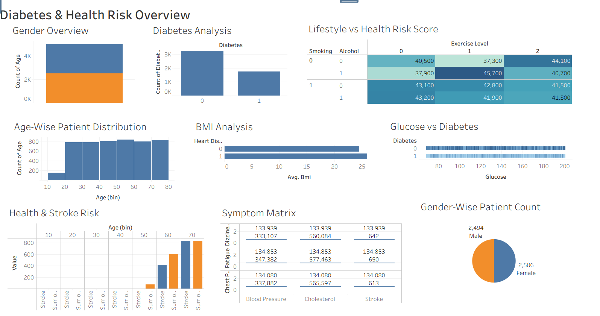

# 🏥 Smart Healthcare & Diabetes Risk Analytics Dashboard

> An interactive Tableau dashboard that explores how patient demographics, clinical biometrics, and lifestyle habits relate to diabetes and cardiovascular risk.

---

## 🌐 Live Interactive Dashboard

👉 **[Open the Live Dashboard](https://PariSinghal-5.github.io/healthcare-dashboard/)**

Use the filters and hover over the charts to explore patient data by gender, age, diabetes status, and lifestyle factors.

---

## 🖼️ Dashboard Preview



---

## 🎯 Project Objective

Raw healthcare data is hard to interpret. This project converts patient records into clear visuals to answer questions such as:

- How are patients distributed across gender and age groups?
- How many patients are diabetic, and how do glucose and BMI compare between groups?
- How do smoking, alcohol, and exercise levels relate to the Health Risk Score?
- At what age do heart disease and stroke values start rising?
- How do symptoms (chest pain, dizziness, fatigue) relate to blood pressure, cholesterol, and stroke?

---

## ✨ Key Dashboard Features

- **Single-screen overview:** All key charts are combined in one unified view for quick analysis.
- **Demographic analysis:** Gender overview, gender-wise patient count, and age-wise patient distribution.
- **Diabetes analysis:** Comparison of diabetic and non-diabetic patients, along with glucose distribution by diabetes status.
- **Clinical insights:** BMI analysis by heart disease status.
- **Lifestyle risk heatmap:** Color-coded heatmap showing the Health Risk Score across smoking, alcohol, and exercise level combinations.
- **Age-wise risk tracking:** Side-by-side view of heart disease and stroke values across age groups.
- **Symptom matrix:** Maps dizziness, fatigue, and chest pain against blood pressure, cholesterol, and stroke.
- **Interactive exploration:** Hover tooltips and filters let users explore the data in detail.

---

## 🛠️ Tools & Technologies

| Category | Tool | Purpose |
|---|---|---|
| **Data Visualization** | Tableau Public | Building charts, heatmap, and the interactive dashboard |
| **Data Source** | CSV / Excel | Smart Healthcare Dataset |
| **Hosting** | GitHub Pages | Serving the dashboard as a live web page |
| **Version Control** | Git & GitHub | Repository management |

---

## 📁 Dataset

**Smart Healthcare Dataset** with these types of fields:

- **Demographics:** age, gender
- **Clinical metrics:** glucose, BMI, blood pressure, cholesterol
- **Lifestyle factors:** smoking, alcohol, exercise level
- **Symptoms and conditions:** chest pain, dizziness, fatigue, heart disease, stroke, diabetes

---

## 💻 How to Run Locally

**1. Clone the repository**
```bash
git clone https://github.com/PariSinghal-5/healthcare-dashboard.git
cd healthcare-dashboard
